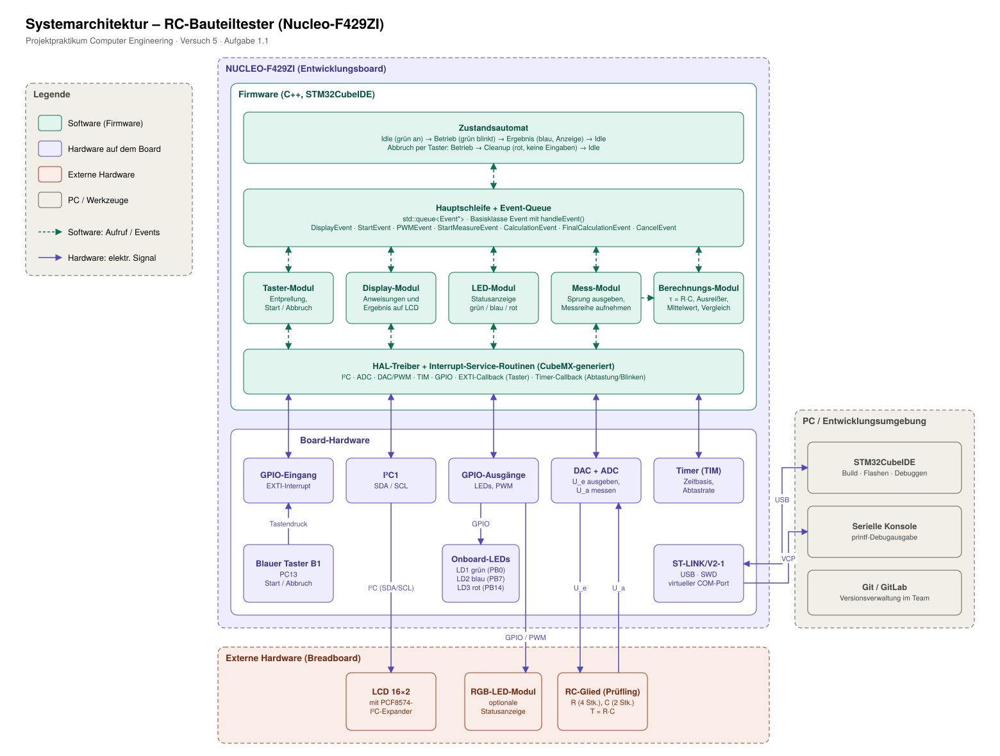

# Projektpraktikum – RC-Bauteiltester

Wir entwickeln auf dem **Nucleo-F429ZI** einen Bauteiltester, der die **Zeitkonstante τ = R·C** eines RC-Glieds misst und interaktiv über ein LCD bedient wird (Projektphase, Gruppe IC – Systemidentifikation).

## Versuch 5 – Kick-off Projektphase

| Aufgabe | Wo? |
|---|---|
| 1.1 Systemarchitektur | [`Systemarchitektur.drawio`](Systemarchitektur.drawio) (Bild unten) |
| 1.2 Arbeitspakete & Abhängigkeiten | [Issue #21 – Projektübersicht](../../issues/21) · Arbeitspakete als [Issues #2–#18](../../issues) |
| 2.1 / 2.2 Zeitplan mit Meilensteinen | [Meilensteine](../../milestones) · Roadmap im GitHub-Project · Gantt in [#21](../../issues/21) |
| 2.3 Tools & Git-Workflow | [Issue #22](../../issues/22) |
| 2.4 Einrichtung im Team | [Issue #19 – Onboarding](../../issues/19) |

## Team

| Name | GitHub | Rolle |
|---|---|---|
| | | |
