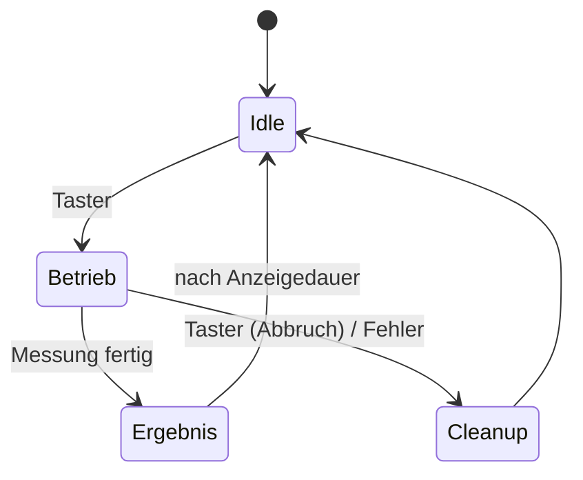

# RC-Bauteiltester – Zeitkonstante τ = R·C auf dem STM32


> **English summary:** Embedded component tester on an STM32 Nucleo-F429ZI that measures the time constant τ = R·C of an RC circuit. The C++ firmware uses an event queue and a state machine; the device is operated via a push button and a 16×2 I²C LCD. Developed as a team Scrum project at RWTH Aachen University (Computer Engineering lab, winter term 2026/27).

Projektpraktikum Computer Engineering, RWTH Aachen, WS 2026/27 – Gruppe IC (Lehrstuhl Intelligent Control Systems), Thema *Systemidentifikation*.

## Funktionsumfang

- Messung der Zeitkonstante τ eines RC-Glieds über die Sprungantwort (DAC/PWM-Ausgang, ADC-Messreihe)
- Mehrere Messdurchläufe, Ausreißerbereinigung, Mittelwert und Vergleich mit dem Theoriewert
- Nutzerführung über LCD 16×2 (I²C, PCF8574) und blauen Taster mit Software-Entprellung
- Statusanzeige über die Onboard-LEDs, Abbruch jederzeit möglich
- Fehlererkennung: kein Bauteil, Kurzschluss, Wert außerhalb des Messbereichs, Timeout

## Hardware und Software

| Bereich | Komponenten |
|---|---|
| Board | STM32 Nucleo-F429ZI (STM32F429ZI, ST-LINK/V2-1) |
| Bedienung | Taster B1 (PC13, EXTI), LD1 grün (PB0), LD2 blau (PB7), LD3 rot (PB14) |
| Extern | LCD 16×2 mit PCF8574-I²C-Expander, RC-Glied auf dem Breadboard |
| Firmware | C++ mit STM32 HAL, STM32CubeIDE |
| Werkzeuge | Git/GitHub, GitHub Projects, draw.io |

## Architektur


Quelle: [`Systemarchitektur.drawio`](Systemarchitektur.drawio)

Die Module (Taster, Display, LED, Messung, Berechnung) kommunizieren ausschließlich über eine **Event-Queue** (`std::queue<Event*>`, Basisklasse `Event` mit `handleEvent()`). Ein Zustandsautomat steuert den Ablauf:



## Bedienung

| Zustand | LED | Bedeutung |
|---|---|---|
| Idle | LD1 grün dauerhaft | Bereit – blauen Taster drücken |
| Betrieb | LD1 grün blinkend | Messung läuft – Taster bricht ab |
| Cleanup | LD3 rot | Abbruch, Eingaben werden ignoriert |
| Ergebnis | LD2 blau | τ wird auf dem LCD angezeigt |

Eine ausführliche Kurzanleitung folgt mit [AP17](https://github.com/Mekin66/Projektpraktikum/issues/18).

## Projektorganisation

Planung und Dokumentation laufen vollständig über GitHub:

- **[Project-Board und Roadmap](https://github.com/Mekin66/Projektpraktikum/projects)** – Kanban (Todo → In Arbeit → Review → Erledigt) und Gantt-Ansicht
- **[Meilensteine](https://github.com/Mekin66/Projektpraktikum/milestones)** – Sprint 1 (Inkrement 1, 13.12.2026) und Sprint 2 (Endprodukt, 24.01.2027)
- **[#21 Projektübersicht](https://github.com/Mekin66/Projektpraktikum/issues/21)** – Arbeitspakete AP1–AP17, Abhängigkeiten, Zeitplan
- **[#22 Tools und Git-Workflow](https://github.com/Mekin66/Projektpraktikum/issues/22)** – Branch-, Commit- und Review-Regeln
- **[#19 Team-Onboarding](https://github.com/Mekin66/Projektpraktikum/issues/19)**

| Termin | Datum |
|---|---|
| Sprint 1 | 21.11.–13.12.2026 |
| Zwischenpräsentation | KW 51 (14.–18.12.2026) |
| Sprint 2 | 19.12.2026–24.01.2027 |
| Abschlusspräsentation | KW 5 (25.–29.01.2027) |

## Team

| Name | GitHub | Rolle |
|---|---|---|
| | | A – Firmware-Kern (Event-Framework, Zustandsautomat) |
| | | B – Bedienung (Taster, LEDs, Fehlerbehandlung) |
| | | C – Messtechnik (RC-Glied, Messung, Berechnung) |
| | | D – Display & Dokumentation |

Betreuer: Product Owner · Tutoren: Scrum Master

## Repository-Struktur

```
firmware/                  STM32CubeIDE-Projekt (ab AP1)
Systemarchitektur.drawio   Architekturschaubild (Quelle)
Systemarchitektur.png      Architekturschaubild (Export)
.github/                   Issue- und Pull-Request-Vorlagen
```

## Lizenz

[MIT](LICENSE)
