# Aufgabe 1.2 – Arbeitspakete und Abhängigkeiten

Die Arbeitspakete (AP) sind direkt aus der [Systemarchitektur](architektur/Systemarchitektur.png) abgeleitet: Jeder Block des Schaubilds gehört zu genau einem Paket. Ausführliche Beschreibung, Akzeptanzkriterien und Status stehen in den zugehörigen GitHub-Issues.

## Rollen

Jedes Teammitglied übernimmt eine Rolle und ist für die zugehörigen Pakete verantwortlich. Bei drei Personen werden die Rollen B und D zusammengelegt, bei zwei Personen A+B und C+D.

| Rolle | Schwerpunkt | Name |
|---|---|---|
| A | Firmware-Kern (Framework, Zustandsautomat) | _eintragen_ |
| B | Bedienung (Taster, LEDs, Fehlerbehandlung) | _eintragen_ |
| C | Messtechnik (RC-Glied, Messung, Berechnung) | _eintragen_ |
| D | Display & Dokumentation | _eintragen_ |

## Sprint 1 – Inkrement 1 (nur Onboard-Peripherie)

Zeitraum: 21.11.–13.12.2026

| AP | Arbeitspaket | Rolle | Zeitraum | abhängig von |
|---|---|---|---|---|
| AP1 | Projektsetup & Repository | A | 21.11.2026 – 22.11.2026 | – |
| AP2 | Event-Framework (Event-Queue) | A | 23.11.2026 – 28.11.2026 | AP1 |
| AP3 | Taster & Interrupt (EXTI) | B | 23.11.2026 – 01.12.2026 | AP1 |
| AP4 | LED-Statusanzeige | B | 23.11.2026 – 01.12.2026 | AP1 |
| AP5 | Display-Modul (LCD über I²C) | D | 23.11.2026 – 05.12.2026 | AP1 |
| AP6 | Zustandsautomat (Idle/Betrieb/Cleanup/Ergebnis) | A | 29.11.2026 – 06.12.2026 | AP2 |
| AP7 | Integration & Test Inkrement 1 | alle | 07.12.2026 – 11.12.2026 | AP3, AP4, AP5, AP6 |
| AP8 | Zwischenpräsentation vorbereiten | D | 09.12.2026 – 13.12.2026 | AP6 |

## Sprint 2 – Inkrement 2 (Endprodukt)

Zeitraum: 19.12.2026–24.01.2027

| AP | Arbeitspaket | Rolle | Zeitraum | abhängig von |
|---|---|---|---|---|
| AP9 | Sprint-2-Planung & Projektplan aktualisieren | alle | 19.12.2026 – 20.12.2026 | M2 |
| AP10 | Entprellung des Tasters | B | 21.12.2026 – 28.12.2026 | AP9 |
| AP11 | RC-Glied aufbauen & beschalten | C | 21.12.2026 – 29.12.2026 | AP9 |
| AP12 | Nutzerführung über Display (Pflicht) | D | 21.12.2026 – 10.01.2027 | AP9 |
| AP13 | Messung (Sprung ausgeben, ADC-Messreihe) | C | 30.12.2026 – 10.01.2027 | AP11 |
| AP14 | Berechnung der Zeitkonstante | C | 30.12.2026 – 12.01.2027 | AP11 |
| AP15 | Fehlerbehandlung & Fehleingaben | B | 11.01.2027 – 16.01.2027 | AP12, AP13 |
| AP16 | Integration & Systemtest Inkrement 2 | alle | 17.01.2027 – 21.01.2027 | AP10, AP14, AP15 |
| AP17 | Abschlusspräsentation & Kurzanleitung | D | 18.01.2027 – 24.01.2027 | AP15 |

## Was ist sequenziell, was parallel?

**Sequenziell (blockierend):**

- **AP1 Projektsetup** steht am Anfang, weil alle anderen Pakete auf dem gemeinsamen CubeIDE-Projekt aufbauen.
- **AP2 Event-Framework → AP6 Zustandsautomat**: Der Zustandsautomat arbeitet ausschließlich über Events.
- **AP11 RC-Glied → AP13 Messung**: Ohne aufgebaute Schaltung gibt es keine echten Messwerte.
- **Integration (AP7, AP16)** und **Präsentationen (AP8, AP17)** schließen jeden Sprint ab.

**Parallel (gleichzeitig bearbeitbar):**

- Nach AP1: **AP2** (Rolle A), **AP3 + AP4** (Rolle B) und **AP5** (Rolle D) – getrennte Module mit klarer Schnittstelle (Events).
- Nach AP9: **AP10** (B), **AP11** (C) und **AP12** (D).
- Nach AP11: **AP13** und **AP14** – die Berechnung wird zunächst mit simulierten Messdaten entwickelt und später mit echten Daten getestet.

Damit alle gleichzeitig arbeiten können, kommunizieren die Module nur über die Event-Queue. Die Schnittstellen (Event-Klassen) werden in AP2 als Erstes festgelegt.

## Abhängigkeitsgraph

```mermaid
flowchart LR
  subgraph S1[Sprint 1]
    AP1["AP1: Projektsetup & Repository"]
    AP2["AP2: Event-Framework (Event-Queue)"]
    AP3["AP3: Taster & Interrupt (EXTI)"]
    AP4["AP4: LED-Statusanzeige"]
    AP5["AP5: Display-Modul (LCD über I²C)"]
    AP6["AP6: Zustandsautomat (Idle/Betrieb/Cleanup/Ergebnis)"]
    AP7["AP7: Integration & Test Inkrement 1"]
    AP8["AP8: Zwischenpräsentation vorbereiten"]
    M1{{"Inkrement 1 fertig"}}
    M2{{"Zwischenpräsentation (KW 51)"}}
  end
  subgraph S2[Sprint 2]
    AP9["AP9: Sprint-2-Planung & Projektplan aktualisieren"]
    AP10["AP10: Entprellung des Tasters"]
    AP11["AP11: RC-Glied aufbauen & beschalten"]
    AP12["AP12: Nutzerführung über Display (Pflicht)"]
    AP13["AP13: Messung (Sprung ausgeben, ADC-Messreihe)"]
    AP14["AP14: Berechnung der Zeitkonstante"]
    AP15["AP15: Fehlerbehandlung & Fehleingaben"]
    AP16["AP16: Integration & Systemtest Inkrement 2"]
    AP17["AP17: Abschlusspräsentation & Kurzanleitung"]
    M3{{"Inkrement 2 fertig"}}
    M4{{"Abschlusspräsentation (KW 5)"}}
  end
  AP1 --> AP2
  AP1 --> AP3
  AP1 --> AP4
  AP1 --> AP5
  AP2 --> AP6
  AP3 --> AP7
  AP4 --> AP7
  AP5 --> AP7
  AP6 --> AP7
  AP6 --> AP8
  M2 --> AP9
  AP9 --> AP10
  AP9 --> AP11
  AP9 --> AP12
  AP11 --> AP13
  AP11 --> AP14
  AP12 --> AP15
  AP13 --> AP15
  AP10 --> AP16
  AP14 --> AP16
  AP15 --> AP16
  AP15 --> AP17
  AP7 --> M1
  AP8 --> M2
  M1 --> M2
  AP16 --> M3
  AP17 --> M4
  M3 --> M4
```

