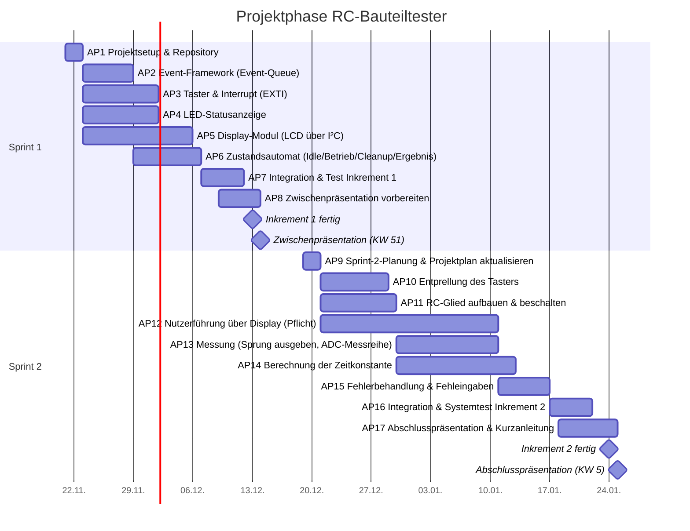

# Aufgabe 2.2 – Zeitplan (Gantt-Diagramm)

Die editierbare Version liegt als GanttProject-Datei unter [`planung/Projektplan.gan`](../planung/Projektplan.gan) (in GanttProject über *Projekt → Öffnen*). Das Diagramm unten wird von GitHub direkt angezeigt.

## Meilensteine

| Meilenstein | Datum | Ziel |
|---|---|---|
| M1 Inkrement 1 fertig | 13.12.2026 | Inkrement 1 erfüllt Product Backlog 1 (Ablauf mit Onboard-Peripherie, Abbruch, Cleanup, Ergebnis) |
| M2 Zwischenpräsentation (KW 51) | 14.12.2026 | Vorführung von Inkrement 1 vor dem Product Owner (genaues Datum in KW 51 eintragen) |
| M3 Inkrement 2 fertig | 24.01.2027 | Endprodukt erfüllt alle Mindestanforderungen (Zeitkonstante genau messen, Display-Führung, Fehlerbehandlung) |
| M4 Abschlusspräsentation (KW 5) | 25.01.2027 | Funktionsdemo und schriftliche Kurzanleitung (genaues Datum in KW 5 eintragen) |

## Gantt-Diagramm

Zwischen 14.12. und 18.12.2026 findet die Zwischenpräsentation statt; die Feiertage sind im Zeitraum von AP10–AP14 mit Puffer eingeplant.
